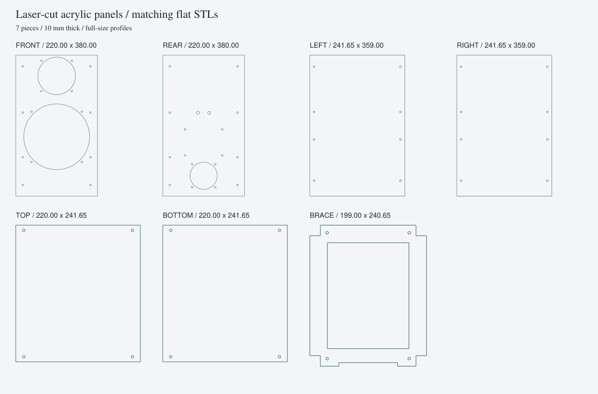

# Tifa 6 acrylic speaker enclosure

Laser-cut patterns, matching flat panel STLs, and printed fittings for one rectangular, M3-assembled speaker enclosure.

**220 W x 380 H x 262.652 D mm · 10 mm acrylic · approximately 16.1 L net volume**



## Files to use

- **[Download the acrylic build](https://github.com/timothyosm/tifa6-acrylic-speaker/releases/latest/download/tifa6-current-build.zip)**
- [Laser-cut patterns: DXF and SVG](exports/current/laser/)
- [STL files: flat panels and fittings](exports/current/stl/)
- [Parts manifest](exports/current/print-manifest.csv)
- [STEP assembly](exports/current/step/assembly_with_components.step)
- [Fit coupon](exports/calibration/)

Cut **seven acrylic pieces**: front, rear, left, right, top, bottom and window brace. The matching seven panel STLs are full outlines extruded to 10 mm, lying flat, with the same holes and cutouts. All dimensions are millimetres; do not scale.

Print the **12 fittings** used by the acrylic enclosure: eight corner-rail pieces, two woofer-adapter halves, one tweeter adapter and one continuous bass-reflex port. The port is `bass_reflex_port.stl`: 50 mm bore, 185 mm long, with a flared outlet. Rails and adapters use the established split geometry. There are no tiled cabinet panels or splice strips.

## Assembly

- [Assembly instructions](docs/current/assembly-instructions.md)
- [Hardware list](docs/current/hardware.md)
- [Cutting and printing instructions](docs/current/printing-and-cutting.md)
- [Fastener locations](exports/current/fastener-map.csv)
- [Verification and acoustic notes](docs/current/verification-and-acoustics.md)

All panel joints use M3 screws and replaceable gaskets. Hardware includes **72 M3 screws, 60 inserts and four port nuts**, plus washers, crossover spacers and binding-post hardware. The rear panel removes with the port and crossover attached. Install the brace before the front/driver assembly.

Use nominal 10 mm acrylic and uncompensated cutting profiles. Confirm actual stock thickness and laser kerf using the coupon. Heat-set inserts belong in the printed fittings, never in acrylic.

## CAD and checks

[Editable source](cad/speaker_assembly.py) · [Parameters](cad/speaker_parameters.json) · [FreeCAD assembly](cad/speaker_assembly.FCStd) · [Validation report](exports/current/verification.json)

With Python 3.12 and the packages in `cad/requirements.txt`, regenerate and check the files:

```sh
python cad/speaker_assembly.py
python cad/inspect_geometry.py
python cad/verify_profiles.py
```

`cad/render_views.py` regenerates the views. Run `cad/freecad_project.FCMacro` in FreeCAD, then `cad/verify_freecad.py` with FreeCAD's Python runtime to rebuild and check the native document. Python/JSON is the parametric source; FCStd holds imported solids and a dimension sheet. The manufacturing layout assumes 220 x 380 mm and 10 mm stock.

Geometry, panel-profile consistency and mounting clearances are checked digitally. Physical fabrication, fit, sealing, strength and sound remain untested. The flat baffle and acrylic construction differ from the original Tifa cabinet; acoustic equivalence is not established.

## References

This independent enclosure derivative uses the original SB Acoustics SB16PFCR25-4, SB26ST-C000-5 and Tifa 6 crossover. Keep the specified electrical components and polarity. See the [official source links](docs/source-register.md); manufacturer PDFs are linked rather than redistributed.
